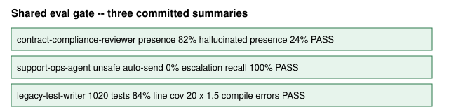
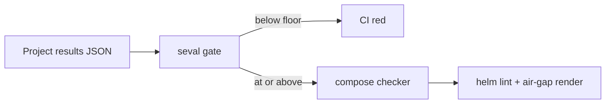

# Shared Eval and Deploy

**A 48-hour extraction:** the eval gate and the deploy template every other repo in this
portfolio was already using, lifted into one place so a new project does not invent a third
way to fail CI or a second way to go air-gapped.

> Built to answer the question a hiring manager asks after seeing four prototypes:
> *"Would the fifth one deploy the same way, and would CI catch a silent regression?"*
> The answer here is one assertion runner and one chart. The three existing summaries
> replay against it. Floors are not raised to make a run green.



## What it is

**Eval.** A promptfoo-style check: path, operator, floor. No API key. Each project still
owns its cases and its scorer; this repo owns the gate. CI in this repo replays the
committed summaries from `contract-compliance-reviewer`, `support-ops-agent`, and
`legacy-test-writer`.

**Deploy.** The compose file `contract-compliance-reviewer` already shipped (`depends_on:
condition: service_healthy`, so `docker compose up --wait` actually waits). The Helm chart
it already shipped (non-root, readiness probe, NetworkPolicy that drops 443 when
`offline: true`). Both live here as the template. A checker fails the PR if someone
checks in a compose file that `up --wait` cannot wait on, or an "offline" chart that still
allows HTTPS.



| Check | Result |
|---|---|
| Three portfolio summaries vs their floors | pass |
| Compose template ready for `--wait` | pass |
| Offline chart still allows 443 | would fail; the template does not |

## Run it

```
uv sync --extra dev
uv run pytest
uv run seval compose
uv run seval gate --summary examples/summaries/legacy-test-writer.json --gate examples/gates/legacy-test-writer.yaml
```

`uv run seval chart` needs `helm` on PATH. CI installs it.

To put a new project on the same rails: emit a results JSON, write a gate YAML of path
checks, copy `deploy/compose/compose.yaml` next to the Dockerfile, and `helm install` with
`-f` values that set `offline: true` when the customer has no egress.

## What was extracted, not invented

The chart and compose file come from the anchor project. The gate file shape comes from
the three eval runners. This repo is the proof that the pattern is one pattern. Details in
[ATTRIBUTION.md](ATTRIBUTION.md) and [docs/writeup.md](docs/writeup.md).
